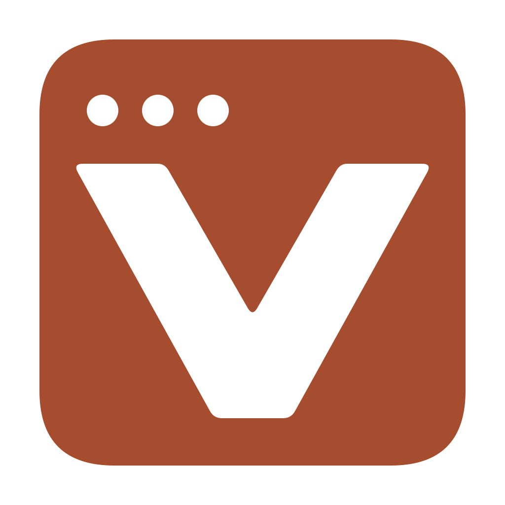

# VMac



VMac 是 Apple Silicon Mac 上的 macOS 虚拟机工作台。客机画面通过 Apple Virtualization.framework 嵌在同一个应用窗口里，可运行 Claude Desktop 和其他 macOS 应用。

- **虚拟机管理**可新建或切换客机，查看和扩大虚拟磁盘，并在已启动的客机内使用 Mole 扫描缓存。
- **代理管理**提供 Mihomo 节点、流量和网关检测。各客机共用 VMac 的代理设置，实际连接状态按当前客机显示。
- 每台客机都有独立的磁盘、安装进度和文件授权。VMac 的原生工作台支持手动上传文件及文字、图片剪贴板同步。

## 构建

使用 Apple Silicon Mac，准备 Xcode Command Line Tools、Go（版本见 [go.mod](go.mod)）、Node.js 和 Python 3。SSHFS 的构建还需要与 [依赖锁定文件](scripts/guest-os/macos-sshfs-dependencies.json) 一致的 Homebrew GLib、gettext 和 PCRE2。其余构建步骤见 [构建脚本](scripts/build-vmac.sh)。

```sh
bash scripts/build-vmac.sh
open _output/VMac.app
```

脚本生成签名后的 `_output/VMac.app`。再次构建可用 `VMAC_BUILD_OUTPUT` 指定一个尚不存在的绝对 `.app` 路径。

## 数据与升级

主数据在 `~/.vmac`，下载目录在 `~/.vmac-downloads`。启动新版时会导入旧 VMac 应用身份下的客机列表、当前客机和侧栏偏好。已安装客机可继续使用现有组件，也可通过工作台更新组件。

从仍使用旧数据目录的版本迁移时，先完全退出旧应用，再运行 `_output/VMac.app/Contents/Resources/vmac vmac-migrate`。原客机在「虚拟机管理 → 虚拟机切换 → 原有 macOS 客机」。

## 来源与许可

VMac 基于 [Claude Cage](https://github.com/Lee-xeo/Claude-Cage) 与 [agent-vm](https://github.com/sylvinus/agent-vm) 开发。原作者、贡献者和第三方组件的署名及许可见 [LICENSE](LICENSE)、[NOTICE](NOTICE) 和 [THIRD_PARTY_LICENSES](THIRD_PARTY_LICENSES)。
